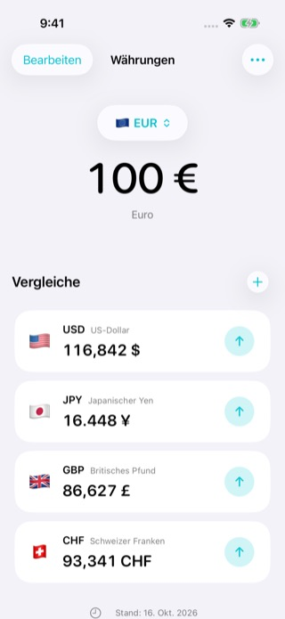
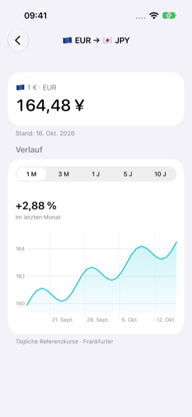
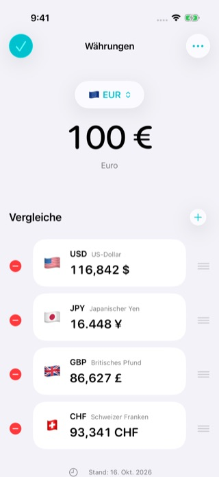
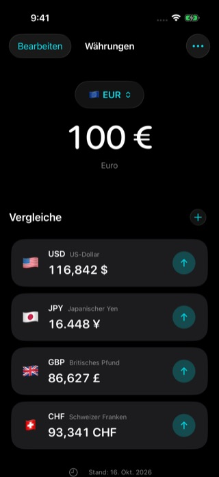
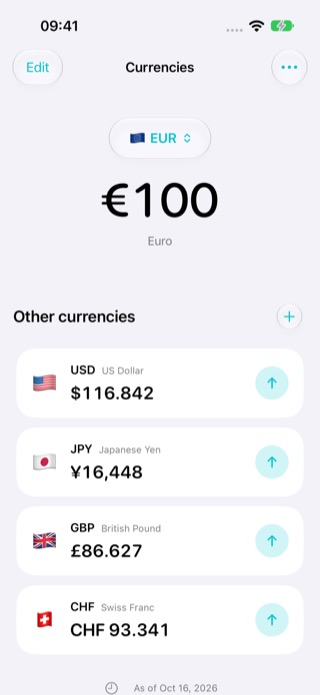
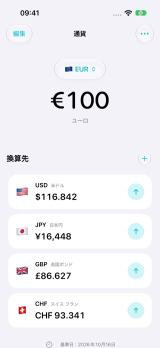
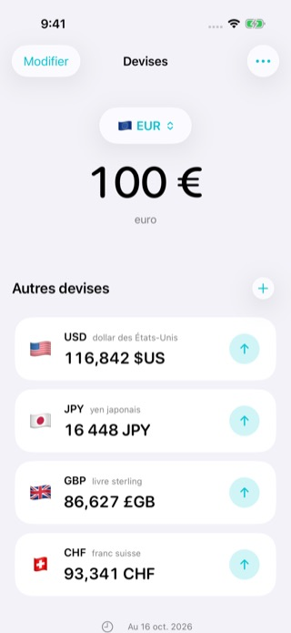

# Devisen

Eine kleine native iPhone- und iPad-App ab iOS 26 mit SwiftUI, Swift Charts und einem synchronisierten WidgetKit-Widget. Keine externen Bibliotheken, kein API-Schlüssel.

<!-- screenshots:start -->
## Screenshots

Automatisch mit nativen UI-Tests erstellt, mit festen Beispieldaten. Hier werden nur verkleinerte JPEGs geladen (320 Pixel breit). Ein Klick öffnet das unverkleinerte PNG im Repository.

| Übersicht | Verlauf | Bearbeiten | Dunkelmodus |
| --- | --- | --- | --- |
| <a href="docs/screenshots/originals/de/overview-light.png"></a> | <a href="docs/screenshots/originals/de/history.png"></a> | <a href="docs/screenshots/originals/de/editing.png"></a> | <a href="docs/screenshots/originals/de/overview-dark.png"></a> |

| English | 日本語 | Español | Français |
| --- | --- | --- | --- |
| <a href="docs/screenshots/originals/en/overview-light.png"></a> | <a href="docs/screenshots/originals/ja/overview-light.png"></a> | <a href="docs/screenshots/originals/es/overview-light.png"></a> | <a href="docs/screenshots/originals/fr/overview-light.png"></a> |

<details>
<summary>Alle Originale in voller Auflösung (PNG)</summary>

| Sprache | Übersicht | Verlauf | Bearbeiten | Dunkelmodus |
| --- | --- | --- | --- | --- |
| Deutsch | [Übersicht](docs/screenshots/originals/de/overview-light.png) | [Verlauf](docs/screenshots/originals/de/history.png) | [Bearbeiten](docs/screenshots/originals/de/editing.png) | [Dunkelmodus](docs/screenshots/originals/de/overview-dark.png) |
| English | [Übersicht](docs/screenshots/originals/en/overview-light.png) | [Verlauf](docs/screenshots/originals/en/history.png) | [Bearbeiten](docs/screenshots/originals/en/editing.png) | [Dunkelmodus](docs/screenshots/originals/en/overview-dark.png) |
| 日本語 | [Übersicht](docs/screenshots/originals/ja/overview-light.png) | [Verlauf](docs/screenshots/originals/ja/history.png) | [Bearbeiten](docs/screenshots/originals/ja/editing.png) | [Dunkelmodus](docs/screenshots/originals/ja/overview-dark.png) |
| Español | [Übersicht](docs/screenshots/originals/es/overview-light.png) | [Verlauf](docs/screenshots/originals/es/history.png) | [Bearbeiten](docs/screenshots/originals/es/editing.png) | [Dunkelmodus](docs/screenshots/originals/es/overview-dark.png) |
| Français | [Übersicht](docs/screenshots/originals/fr/overview-light.png) | [Verlauf](docs/screenshots/originals/fr/history.png) | [Bearbeiten](docs/screenshots/originals/fr/editing.png) | [Dunkelmodus](docs/screenshots/originals/fr/overview-dark.png) |

</details>

<!-- screenshots:end -->

## Starten

1. `Currency.xcodeproj` in Xcode 26 oder neuer öffnen.
2. Scheme **Currency** und einen iPhone-Simulator auswählen, dann ausführen.
3. Für ein echtes Gerät in beiden Targets ein eigenes Signing-Team auswählen. Bundle-IDs und die Build-Einstellung `APP_GROUP_IDENTIFIER` auf eigene registrierte IDs ändern. App und Widget müssen dieselbe App Group verwenden. Die Entitlements und Info.plist-Dateien beziehen den Wert automatisch aus dieser Build-Einstellung.

## Bedienung

- Oben stehen Hauptwährung und Betrag großzügig zentriert. Die Vergleiche erscheinen darunter als einzelne Karten; über den Plus-Button wird die Auswahl bearbeitet. Betrag und Währungsauswahl bleiben beim Schließen der App gespeichert. Kurse und Ergebnisse zeigen Währungssymbole und bis zu zwölf signifikante Stellen. Native Flaggen-Emojis kennzeichnen die Währungen in App und Widget; für den Euro wird die EU-Flagge verwendet, für Währungen ohne eindeutige Länderflagge ein Globus.
- Über den Währungscode die Hauptwährung wählen. Über den **Plus-Button** mehrere Vergleichswährungen an- oder abwählen. Die Listen lassen sich nach Namen und Code durchsuchen.
- Über **Bearbeiten** oben links erscheinen die nativen Verschiebegriffe und Löschbuttons. Die Reihenfolge bleibt gespeichert und bestimmt die ersten drei Währungen im Widget. Auch eine leere Vergleichsliste wird gespeichert.
- Der Pfeil-Button rechts neben jeder Vergleichswährung macht sie zur Hauptwährung. Die alte Hauptwährung nimmt ihren Platz in der Vergleichsliste ein; die übrigen Vergleiche und der eingegebene Betrag bleiben erhalten.
- Ein Tippen auf eine Vergleichswährung öffnet deren Verlauf auf einer eigenen Seite. Dort einen Zeitraum wählen und das Diagramm zum Ablesen berühren. Es zeigt den Kurs pro einer Einheit der Ausgangswährung, unabhängig vom eingegebenen Betrag. Fünf Jahre verwenden wöchentliche, zehn Jahre monatliche Datenpunkte.
- Zum Aktualisieren nach unten ziehen oder **… → Aktualisieren** wählen. Datenquelle und Widget-Hilfe stehen unter **… → Über Devisen**.
- Homescreen gedrückt halten → **Bearbeiten → Widget hinzufügen → Devisen**. Das Widget unterstützt kleine und mittlere Größen: kompakt mit hervorgehobenem Ausgangsbetrag oder mit separatem Betragsbereich und Vergleichskarten. Beide verwenden native SwiftUI-Layouts und Systemfarben für Hell- und Dunkelmodus. Das Widget übernimmt automatisch den Betrag, die Hauptwährung und die ersten drei Vergleichswährungen in der Reihenfolge der App. Es hat keine eigene Auswahl mehr. Ein Tippen öffnet die App und erhält ihre vollständige Liste, auch wenn sie mehr als drei Vergleiche enthält.

## Sprachen

App und Widget unterstützen Deutsch, Englisch, Japanisch, Spanisch und Französisch. Die Sprache wird automatisch anhand der iOS-Sprachpräferenzen gewählt; eine eigene App-Sprache lässt sich in den iOS-Einstellungen festlegen. Auch App-Name, Widget-Galerie, Hilfetexte, Fehlermeldungen, Diagramm-Zeiträume und VoiceOver-Beschreibungen sind übersetzt. Währungsnamen, Symbole, Beträge und Datumsangaben verwenden die nativen Formate der gewählten Sprache und Region. Gespeicherte Beträge und Währungsauswahl bleiben bei einem Sprachwechsel erhalten.

Die gemeinsamen nativen String Catalogs liegen unter `Shared/Localizable.xcstrings` und `Shared/InfoPlist.xcstrings` und werden in beide Targets eingebunden. Neue Oberflächentexte sollten als SwiftUI-Lokalisierungsschlüssel oder mit `String(localized:)` angelegt werden; die stabilen internen Zeitraumwerte bleiben sprachunabhängig, damit vorhandene Verlaufscaches weiterverwendet werden.

## Daten und Aktualisierung

Die App verwendet die öffentliche [Frankfurter-v2-API](https://frankfurter.dev/): `/currencies`, `/rate/{base}/{quote}` und `/rates` mit `base`, `quotes`, `from`, `to` und optional `group`. Die Kurse sind tägliche Referenzkurse. Der angezeigte Datenstand kommt aus der API, nicht aus der Abrufzeit. Es gibt keine Intraday- oder garantierten Transaktionskurse.

Kurse und Zeitreihen werden lokal zwischengespeichert. App und Widget teilen die letzten Kurse über die App Group; Betrag und die geordnete Währungsauswahl werden zusätzlich als eine atomare Datei in der App Group gespeichert. Die App ist die einzige Quelle für diese Einstellungen; das Widget liest sie und begrenzt lediglich seine Anzeige auf die ersten drei Vergleiche. Bei einem fehlgeschlagenen Abruf werden gespeicherte Daten als solche gekennzeichnet. Ohne gespeicherte Daten wird ein leerer Fehlerzustand angezeigt. Beispielkurse werden nur in der Widget-Vorschau und im separaten Debug-Screenshot-Modus verwendet.

Nach Änderungen in der App wird das Widget zur Aktualisierung aufgefordert. Eingaben werden dabei kurz gebündelt, beim Verlassen der App sofort veröffentlicht. Zusätzlich bittet das Widget iOS nach vier Stunden um eine neue Timeline, bei Fehlern nach 30 Minuten. Den tatsächlichen Zeitpunkt bestimmt iOS.

## Aufbau

- `Currency/`: SwiftUI-Oberfläche und beobachtbares Zustandsmodell.
- `Currency/AppIcon.icon`: Mehrschichtiges, direkt in Xcode eingebundenes Icon-Composer-Dokument mit getrennten Münz- und Symbolebenen. Licht, Material und die Systemdarstellungen werden von Apples Icon Composer gerendert; der Dunkelmodus hat eine eigene kontrastreiche Symbolfüllung.
- `Design/Icon/`: SVG-Quelldateien und ein Swift-Skript zum erneuten Erzeugen der Vektorpfade. Zum Aktualisieren `swift Design/Icon/generate.swift Currency/AppIcon.icon/Assets` ausführen, während das Dokument im Icon Composer geschlossen ist. Das Euro-Zeichen ist optisch anhand seines runden Bogens auf die Münzmitte ausgerichtet; die Korrektur ist im Generator hinterlegt.
- `Shared/`: API-Client, Modelle und Cache, gemeinsam von App und Widget kompiliert.
- `CurrencyWidget/`: Statisches Widget mit gemeinsamer App-Auswahl und Timeline.
- `CurrencyTests/`: HTTP-Fixtures, Decoding, Zeitreihenanfragen, Fehlerbehandlung, Cache und Widget-Deep-Links.

## Prüfung

### Automatische Screenshots

Der [GitHub-Workflow](.github/workflows/screenshots.yml) erstellt die Screenshots bei Änderungen an App, Übersetzungen oder Screenshot-Skripten auf `main` und in Pull Requests. Er lässt sich auch unter **Actions → App screenshots → Run workflow** starten. Auf dem Standardbranch werden neue PNG-Originale, kleine JPEG-Vorschauen und der automatisch erzeugte Screenshot-Abschnitt dieser README gemeinsam vom Actions-Bot committet. In Pull Requests stehen die Ergebnisse als Workflow-Artefakt `screenshot-gallery` zum Herunterladen bereit; native Testergebnisse werden ebenfalls angehängt.

Die Aufnahmen zeigen Übersicht, Verlauf, Bearbeiten und die Übersicht im Dunkelmodus für Deutsch, Englisch, Japanisch, Spanisch und Französisch auf einem iPhone 17. `docs/screenshots/originals/` enthält die unveränderten Simulator-PNGs, `docs/screenshots/previews/` die tatsächlich auf 320 Pixel Breite verkleinerten JPEGs. Die README bindet ausschließlich acht dieser kleinen Vorschauen ein und verlinkt alle zwanzig Originale. `docs/screenshots/manifest.json` enthält Auflösung und Dateigröße jeder Aufnahme.

Lokal mit Xcode 26 oder neuer ausführen:

```sh
bash scripts/screenshots.sh
```

Das Skript erstellt und entfernt einen eigenen Simulator, verwendet ausschließlich feste Beispieldaten und verändert keine gespeicherten Beträge, Währungslisten oder Widget-Einstellungen der normalen App. Der Screenshot-Modus ist nur in Debug-Builds verfügbar. Die Zeit- und Datenangaben sind absichtlich fest, damit sich Screenshots nur bei relevanten Änderungen unterscheiden. System-Mitteilungsbanner werden vor Aufnahmen entfernt und vor sowie nach der Aufnahme geprüft; verdeckte Bilder werden nicht veröffentlicht. Die UI-Tests liegen im separaten Scheme **Screenshots**; die normalen Unit-Tests bleiben im Scheme **Currency**.

Voraussetzung für den automatischen Commit ist, dass die Repository-Regeln Schreibzugriffe des Actions-Bots auf den Standardbranch erlauben. Der Workflow verwendet dafür das eingebaute `GITHUB_TOKEN` mit `contents: write` ausschließlich im Publish-Job; zusätzliche Secrets sind nicht nötig. Bot-Pushes lösen [keinen weiteren Push-Workflow](https://docs.github.com/en/actions/how-tos/write-workflows/choose-when-workflows-run/trigger-a-workflow) aus. Läufe für überholte Commits veröffentlichen keine veraltete README.

### Bisherige Prüfungen

Build und fünfzehn Unit-Tests wurden mit Xcode 27 auf einem iPhone-17-Simulator mit iOS 27 erfolgreich ausgeführt. Deployment Target ist iOS 26. Ein Lauf auf einem iOS-26-Gerät ist noch ausstehend.

Die Oberflächen auf Englisch, Japanisch, Spanisch und Französisch wurden im Simulator geprüft, einschließlich lokaler Zahlen-, Datums- und Währungsformate. Alle vom Compiler extrahierten Oberflächentexte sind übersetzt; Platzhalter und die tatsächlich kompilierten Sprachressourcen wurden für alle fünf Sprachen in App und Widget geprüft.

In Xcode mit **⌘U** testen. Die Unit-Tests laufen gegen lokale HTTP-Fixtures und benötigen keine Netzwerkverbindung. Echte Frankfurter-Abrufe, Mehrfachauswahl, Wechsel der Hauptwährung, Betragserhalt nach einem App-Neustart, die separate Verlaufsansicht, Zehnjahresverlauf, Flaggenanzeige, Sortieren und Löschen, Reihenfolge nach einem App-Neustart, Synchronisierung der ersten drei Vergleiche sowie der Aufruf der App aus einem Widget ohne Verlust der übrigen Vergleiche wurden zusätzlich im Simulator geprüft. Die Startansicht verwendet native SwiftUI-Layouts und Buttons mit semantischen Systemfarben und unterstützt Hell- und Dunkelmodus sowie große Systemschrift.
